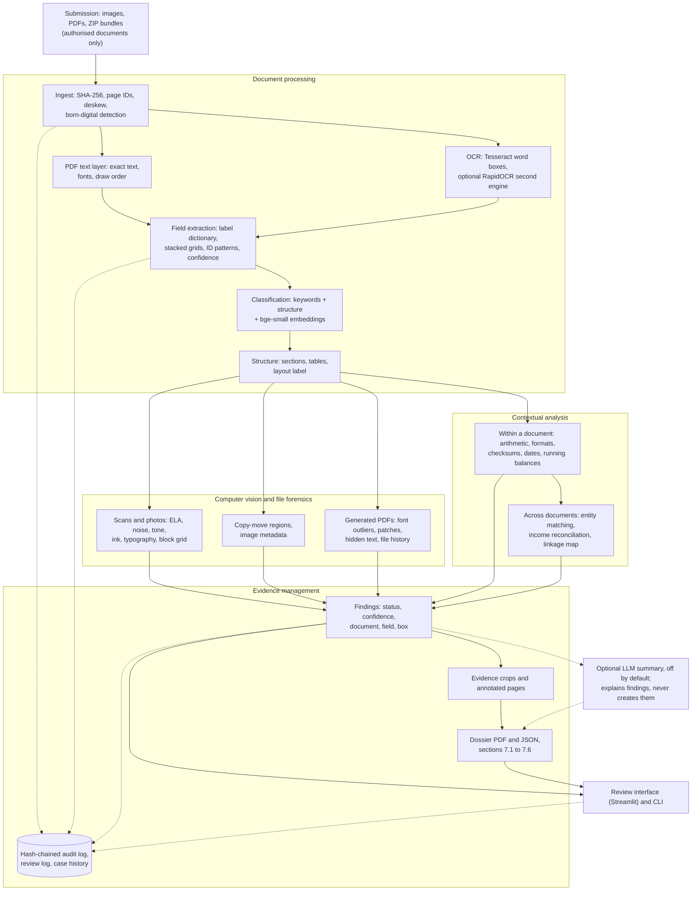

# DocForensics - AI-Powered Document Forensics & Contextual Intelligence

DataOps Innovation Hackathon 2026 (Problem Statement 2). It goes beyond OCR: it reads documents, decides what they are, extracts fields, tests them for signs of tampering, checks documents against themselves and each other, and produces an evidence-mapped investigation dossier (PDF + JSON) with a hash-chained audit trail.

[](https://github.com/ArnavModi-MSIT/DocForensics-Investigator/actions/workflows/ci.yml)

> Visual findings are **indicators** of possible alteration, not proof of fraud. All bundled sample data is fictional.

**Contents:** [Architecture](#architecture) | [Quick start](#quick-start) | [Results](#results) | [Capabilities](#capabilities) | [Limitations](#known-limitations) | [Sample dossier](#sample-dossier) | [Privacy](#privacy) | [Licences](#licences)

## Architecture



**Models and technologies, and what each one does**

| Technology | Role | Limits |
|---|---|---|
| Tesseract (and optional local RapidOCR) | Printed-text OCR with word boxes and confidences | No handwriting; English text only; OCR output is never treated as verified |
| PyMuPDF | Exact text, fonts and drawing order of generated PDFs; page rendering | Structure checks apply to generated PDFs only |
| bge-small-en-v1.5 (ONNX, via fastembed; local, checked against recorded SHA-256 values) | Document-type classification and label matching | Five document types; no training on user data |
| OpenCV / NumPy | Deskew, ELA, noise, tone, copy-move and layout measurements | Heuristic; weak on skilled or AI-generated edits |
| Rule engine (`correlate.py`, `structure.py`) | Arithmetic, format, date, cross-document and reconciliation checks | Conservative rules tuned on synthetic data |
| Optional LLM (off by default) | Writes the investigator summary from existing findings | Needs an API key; never adds findings, values or evidence |

There is no trained anomaly-detection model: the system has no labelled real-world forgeries to train one on, so findings come from explicit checks that can each be explained and traced to a place in a document. The sample dossiers are produced by this pipeline (rules plus the local embedding model), with the LLM summary switched off.

Every finding carries `refs` = (document, field, value, bounding box), so it traces to the exact region of the source file (SHA-256 recorded). Statuses are `potential_manipulation` (visual indicator), `inconsistency` (content conflict) or `observed`; confidence is high (>= 0.80), medium (0.60-0.79) or low (< 0.60). Supported document types: application form, ID card (Aadhaar, PAN, Voter ID), salary slip, bank statement, employment letter.

Module-by-module detail is in [docs/REFERENCE.md](docs/REFERENCE.md); design notes, tests and open questions are in [ARCHITECTURE.md](ARCHITECTURE.md).

## Quick start

Needs Python 3.10+ and the Tesseract binary (`apt install tesseract-ocr`, or the UB-Mannheim installer on Windows; set `TESSERACT_CMD` if it is not found).

```
pip install -r requirements.txt
python -m docforensics.embed_classifier --check      # downloads the ~70 MB embedding model once into ./models
python synth/generate.py                             # fictional sample cases -> samples/
streamlit run app.py                                 # UI: upload images / PDFs / a ZIP, or pick a sample
python -m docforensics.pipeline demo_data/case_tampered --out output/case_tampered     # CLI
pytest -q                                            # unit + end-to-end regression tests
python tests/eval_synth.py                           # benchmark with pass/fail gates
```

**Windows:** double-click `start.cmd` (creates a venv, installs dependencies, generates samples, downloads the model, opens the app). **Docker:** `docker build -t docforensics .` then `docker run -p 8501:8501 -v docfor_models:/app/models docforensics`. The Dockerfile and the CI workflow were written for this repository; the workflow's first run happens on GitHub after the push.

Optional: `pip install -r requirements-optional.txt` adds a local second OCR engine (RapidOCR) for hard pages. An optional LLM summary is off by default, needs `ANTHROPIC_API_KEY`, and sends finding text to an external API only when enabled for a run; without it a deterministic summary is used. More options: [docs/REFERENCE.md](docs/REFERENCE.md).

## Results

Synthetic benchmark, self-generated: evidence that the pipeline works, not real-world accuracy. Clean pages produced no false alarms and classification was correct on every case.

| Capture quality | Naive forgery (pasted value, different ink/tone) | Skilled forgery (font, ink, tone matched; numbers consistent) |
|---|---|---|
| Digital render | 5/5 per case | **0/8** |
| Mild scan | 5/5 per case | **0/8** |
| Hard scan (tilt, blur, JPEG 60) | 10/10 | **0/8** |
| Rough phone photo (5 deg tilt, JPEG 45) | 10/10 | **0/8** |

Field extraction is about 95-100%; remaining errors are OCR slips on IDs. A second pack generated separately with another AI tool (not supplied by the organisers): 108/108 source fields located, 5/5 planted findings found with evidence boxes (IoU 0.99-1.00), 0 substantive findings on the two clean controls. That pack drove fixes, so it is now a regression check, not a held-out test. Thresholds were tuned on synthetic data; expect lower numbers on real documents.

## Capabilities

- **Implemented:** images, PDFs and ZIP bundles; deskew; printed-text OCR with field boxes and confidence; label-free extraction for Indian ID layouts; classification (5 types); scan forensics (ELA, noise, tone, ink, typography, copy-move, image metadata); PDF structure forensics (fonts, patches, hidden text, file history); arithmetic, format, checksum and date checks; tables with running-balance checks; cross-document matching and income reconciliation; evidence crops, dossier PDF/JSON, hash-chained audit and review logs, UI.
- **Planned:** signature authenticity, photo identity matching, JPEG-ghost check, layout-aware models, Hindi/multilingual OCR.
- **Unsupported:** handwriting recognition.

Full capability matrix: [docs/REFERENCE.md](docs/REFERENCE.md).

## Known limitations

- **Skilled forgeries are not detected by pixel forensics.** If font, ink and tone are matched and all numbers stay consistent, nothing flags it.
- Pixel forensics needs at least 4 comparable fields on a page and does not apply to born-digital PDFs (they get structure checks instead). A document forged before it becomes a PDF passes structure checks.
- Handwriting, other table layouts, Hindi and vertical text are not read; OCR errors can create false content mismatches.
- No trained anomaly-detection model is used, so it cannot learn forgery styles the checks do not describe.
- Findings are reviewer prompts, not verdicts; confidence is not a calibrated probability. Legitimate causes of false positives are listed in [docs/REFERENCE.md](docs/REFERENCE.md).

## Sample dossier

Everything bundled is fictional. `demo_data/` holds clean and tampered cases (images and born-digital PDFs); `python synth/make_demo.py` rebuilds it. The sample dossiers were produced by the pipeline itself (rules plus the local embedding model), with the LLM summary off:

- `docs/sample_dossier/case_tampered/dossier.pdf` (plus `dossier.json`, `audit.jsonl` and `evidence/` crops)
- `docs/sample_dossier/pdf_payslip_patched/` and `docs/sample_dossier/pdf_slips_and_bank/`

Verify an audit log: `python -m docforensics.audit verify docs/sample_dossier/case_tampered/audit.jsonl`. The pitch deck is [docs/DocForensics-Hackathon-Deck.pdf](docs/DocForensics-Hackathon-Deck.pdf).

## Privacy

- No real documents are in this repository. `samples/`, `output/` and `models/` are git-ignored; a small fictional set is committed in `demo_data/`.
- Aadhaar numbers are masked in extracted fields, dossier tables, the OCR view and evidence images (first 8 digits blacked out).
- The audit log is hash-chained per run and tamper-evident, but is rewritten if the same case folder is re-run.

## More documentation

[ARCHITECTURE.md](ARCHITECTURE.md) (design, tests, gaps) | [docs/REFERENCE.md](docs/REFERENCE.md) (modules, capability matrix, demo data, false positives) | [docs/RELATED_WORK.md](docs/RELATED_WORK.md) (papers, open-source projects, standards; no compliance claim)

## Licences

Our code is MIT-licensed (see `LICENSE`). Third-party components are permissive (Tesseract, RapidOCR, ONNX Runtime, OpenCV, fastembed / bge-small) except **PyMuPDF (AGPL-3.0)**, which is installed from PyPI and not redistributed here. A closed-source or network-service deployment needs a commercial PyMuPDF licence or a replacement PDF library; the MIT licence covers our own files only.
