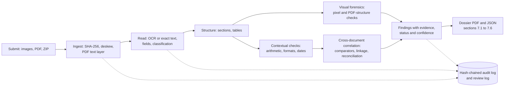

# DocForensics - AI-Powered Document Forensics & Contextual Intelligence

DataOps Innovation Hackathon 2026 (Problem Statement 2). It goes beyond OCR: it reads documents, decides what they
are, extracts fields, tests them for signs of tampering, checks documents against themselves and against each other,
and produces an evidence-mapped investigation dossier (PDF + JSON) with a full audit trail.

[](https://github.com/ArnavModi-MSIT/DocForensics-Investigator/actions/workflows/ci.yml)

> Visual findings are **indicators** of possible alteration, not proof of fraud. All bundled sample data is fictional.

For reviewers: **[ARCHITECTURE.md](ARCHITECTURE.md)** explains how stages 1-4 work, what is tested, the gaps, and open questions.

## Pipeline
`Submission -> Page normalisation -> OCR -> Field extraction -> Classification -> Visual forensics -> Contextual checks -> Cross-document correlation -> Evidence mapping -> Dossier`



| Stage | Module | How |
|---|---|---|
| Ingest | `ingest.py` | Images, PDFs (scanned or generated), ZIP bundles (one zip = one case, safe unpacking). SHA-256 per source, per-page IDs, born-digital PDF detection |
| Page normalisation | `ingest.py` | Deskew (projection-profile, +/-8 deg), applied only when tilt is significant; angle logged |
| OCR | `ocr.py` | Tesseract word boxes + confidences; on poorly read pages (busy backgrounds, photos) it automatically retries with optional local RapidOCR and classic preprocessing variants and keeps the best reading |
| Field extraction | `extract.py`, `id_patterns.py` | Fuzzy label dictionary, **stacked key-value grids (label above value)**, a guard so a neighbouring label is never stored as a value, column-aware label:value cells (labels mid-line), embedding-based label matching for unseen labels, label-free patterns (Aadhaar number with Verhoeff checksum, PAN, name above DOB, address to PIN code). Every field keeps location, confidence and how it was matched |
| Classification | `extract.py`, `embed_classifier.py` | Embeddings (bge-small via fastembed) + whole-word keywords, veto when a page resembles an unsupported class (research paper, resume, invoice), structural gate (>= 3 expected fields, or strong evidence), multi-page continuation. Falls back to keywords + structure if no model |
| PDF text layer | `pdf_layer.py` | Generated (born-digital) PDFs are read from their own text layer: exact text, no OCR misreads, per-span font/size/draw order, drawn rectangles, file metadata. Word boxes are scaled to OCR-like height so every downstream threshold behaves the same on scans and PDFs; reported boxes are restored to the PDF's own geometry. `DOCFOR_PDF_TEXT=off` forces OCR |
| Image checks | `forensics_clone.py` | Duplicated regions (copy-move) on scans and photos: DCT block matching at any shift, then a comparison of the NOISE of the two areas (a copy carries its noise, repeated text does not); EXIF / PNG metadata naming an editor or showing modification after capture. Born-digital pages are skipped for the clone check |
| Visual forensics | `forensics.py` | Per-field ELA, grain noise, paper tone, ink darkness, compared with fields of similar text size on the **same page** (leave-one-out robust z-score), after flattening page lighting. Skipped for born-digital PDFs and when too few comparable fields exist - and the dossier says so |
| PDF structure forensics | `pdf_forensics.py` | For generated PDFs (pixel analysis does not apply): amount set in a different font family, bordered patch of a different colour over a value, text hidden under a later-drawn rectangle, invisible text, file history (revisions, dates, producer). Observations about file structure, never proof |
| Contextual checks | `correlate.py` | Payslip arithmetic, ID formats, Aadhaar checksum, date logic, completeness |
| Structure | `structure.py` | Sections (headings) and tables (bank transactions, earnings/deductions) with running-balance, carried-balance, total-row and component-sum checks; overlay image + UI tab |
| Categories | `embed_classifier.py` | Every page gets a semantic category with a confidence score (16 classes incl. corporate financial report, resume, contract, invoice ...); files of unsupported types are described instead of just called "unknown" |
| Cross-document | `correlate.py` | Per-field comparators (names with initials/order, addresses by PIN, employer suffixes, masked numbers), odd-one-out detection, income reconciliation (declared vs payslip gross/net vs bank, across all payslips) |
| Correlation map | `linkage.py` | Which documents belong together: case reference (header chip or field) must match on every page, documents are linked by shared identifiers (ID, employee ID, account, case code, name, DOB), a document sharing nothing with the others is flagged, and an agreement matrix lists every compared field with the value in each document (dossier section 3b, UI tab 7, `correlation` in dossier.json) |
| Evidence mapping | `evidence.py` | For every finding: a zoomed crop of each region it points to (box in the finding's colour; cross-document findings show both sides in one image; Aadhaar digits blacked out), a plain-language status (confirmed data conflict / potential alteration / observation), why it needs a look and a suggested check. Findings with no region say so. Shown in the dossier (section 3), `dossier.json` (`evidence`) and the UI finding cards |
| Corroboration | `correlate.py` | A content inconsistency on a field that also shows visual evidence is raised in severity |
| Summary | `llm.py` | Optional Claude summary grounded only in produced findings; deterministic fallback |
| Case report | `report.py` | Confidence labels (high / medium / low with a one-paragraph scale), a "what was checked" summary and a case-specific list of areas requiring verification (unread fields, low-confidence pages, checks that could not run, comparisons that were not possible, documents sharing no identifier) |
| Audit trail | `audit.py`, `review.py` | Hash-chained log per run (run ID on every record; chain verified in memory and on disk, result printed in the dossier; `python -m docforensics.audit verify audit.jsonl`). Finding records carry references, source-file SHA-256, evidence-crop SHA-256 and the hashes of the ingest / text / extraction / field-report events that produced them. Earlier runs are archived under `history/` with `case_history.json`; reviewer decisions (confirmed / dismissed / needs more information / note) live in a separate chained `review_log.jsonl` anchored to the run digest |
| Dossier + audit | `dossier.py`, `audit.py` | Annotated pages, PDF/JSON, hash-chained JSONL audit log |

Every finding carries `refs` = (document, field, value, bounding box) so it traces to the exact region of the source.
Findings are `potential_manipulation` (visual indicator), `inconsistency` (content conflict) or `observed`.

**Supported document types:** application form, ID card / identity record (Aadhaar, PAN, Voter ID/EPIC layouts, self-declared identity records), salary slip, bank statement, employment confirmation.

## Setup & run

**Docker (alternative):** `docker build -t docforensics .` then `docker run -p 8501:8501 -v docfor_models:/app/models docforensics` and open http://localhost:8501. (The Dockerfile and the GitHub Actions workflow in `.github/workflows/ci.yml` were written for this repository but have not been run in the development environment; the workflow's first run happens on GitHub after the push.)
**Windows quick start:** double-click `start.cmd` (or run it in a terminal). It creates a virtual environment, installs dependencies, generates the fictional samples, downloads the semantic model once, and opens the app. `start.cmd test`, `start.cmd eval`, `start.cmd cli <file|folder|zip>` and `start.cmd help` are also available. Tesseract OCR must be installed separately (see below).

Python 3.10 (recommended and what `start.cmd` picks automatically via the `py` launcher; 3.11-3.13 also work) and the Tesseract binary (`apt install tesseract-ocr`, or the Windows installer from UB-Mannheim; common
install paths are auto-detected, or set `TESSERACT_CMD`).
```
pip install -r requirements.txt
python -m docforensics.embed_classifier --check      # downloads the ~70 MB embedding model once into ./models
python synth/generate.py                             # fictional baseline cases -> samples/
python synth/generate.py --hard                      # held-out benchmark cases
streamlit run app.py                                 # UI (upload images / PDFs / a ZIP, or pick a sample)
python -m docforensics.pipeline samples/case_tampered --out output/case_tampered     # CLI
pytest -q                                            # unit + end-to-end regression tests (exit code != 0 on regression)
python tests/eval_synth.py                           # full benchmark with pass/fail gates; DOCFOR_EMBED=off to compare without the model
python tests/test_id_cards.py                        # fictional Aadhaar-style card test (asserts)
```
**OCR engines:** `pip install -r requirements-optional.txt` (`start.cmd` does this automatically and only warns if it fails) installs `rapidocr` + `onnxruntime`, a local second engine (works on Python 3.13+; models are bundled); nothing is sent anywhere. Pages Tesseract reads with mean confidence < 0.60 (or < 8 words) are re-read with RapidOCR, then with preprocessing variants if still poor, and the best reading wins (the engine used is recorded per page in the audit log and `doc.facts['ocr_engine']`). `DOCFOR_OCR=tesseract` disables retries, `DOCFOR_OCR=rapid` tries RapidOCR first, `DOCFOR_OCR_RETRY_CONF` changes the threshold. Without RapidOCR everything still works on Tesseract alone.

Optional LLM summary is **opt-in per run** (UI checkbox, or `--llm` on the CLI) and needs `ANTHROPIC_API_KEY` (model via `DOCFOR_MODEL`). When enabled, finding text (names, numbers, dates taken from the documents) is sent to an external API. Without it a deterministic summary is used. Without the embedding model the system
still runs on keywords + structure. The UI has three tabs: **Dossier** (verdict banner, summary, downloads, findings with zoomed evidence, why it needs a look, suggested check and a reviewer-decision form, cross-document comparison, areas requiring verification), **Documents** (annotated page, extracted fields, tables; classification, OCR and forensic details are collapsed under "How this page was processed") and **Audit & history** (chain status, runs, reviewer decisions, processing log).

## Results (synthetic benchmark - self-generated, treat as evidence the pipeline works, not as real-world accuracy)
Clean pages never produced a false alarm, and classification was correct on every case.

| Capture quality | Naive forgery (pasted value, different ink/tone) | Skilled forgery (font, ink, tone matched; all numbers consistent) |
|---|---|---|
| Digital render | 5/5 per case | **0/8** |
| Mild scan | 5/5 per case | **0/8** |
| Hard scan (tilt, blur, JPEG 60) | 10/10 (2 unseen people) | **0/8** |
| Rough phone photo (5 deg tilt, JPEG 45) | 10/10 (2 unseen people) | **0/8** |

Field extraction: about 95-100%. The remaining errors are OCR slips on IDs, which can cause false content mismatches.
Thresholds were tuned on this synthetic data, so expect lower numbers on real documents.

### Second synthetic test pack (generated separately with another AI tool; not supplied by the organisers)
`python -m tests.eval_pack PACK_DIR` scores a pack with an answer key (`GROUND_TRUTH.json`, kept out of the uploaded folders).
On this pack (case A clean control, B edited salary, C two cross-document mismatches, D noisy scanned identity):
108/108 source fields located with the right text, 5/5 planted findings found with evidence boxes (IoU 0.99-1.00), 0 substantive findings on the
two clean controls. B-03 is reported as a *potential alteration* (observation), B-01/B-02/C-01/C-02 as *inconsistencies*, never as fraud.
The first blind run, before the stacked-layout and text-layer work, scored 0/5 with false HIGH findings on the clean control; the pack was used to drive those fixes, so it now serves as a regression check and no longer as a held-out test.

Real files used for checking behaviour (not part of the benchmark, not in this repo): a bank statement and an Aadhaar card
are recognised and extracted; a sales report, a resume and a research paper are rejected.

## Capability matrix
| Capability | Status |
|---|---|
| Label-free Indian ID layouts: Aadhaar (checksum), PAN stacked layout, Voter ID (EPIC); back of a card linked to its front by the repeated ID number | Implemented |
| Images, PDFs, ZIP bundles; multi-document cases; multi-page continuation | Implemented |
| Deskew, lighting flattening | Implemented (perspective correction planned) |
| Printed-text OCR, field confidence and boxes | Implemented (Tesseract; optional local RapidOCR second engine for hard pages) |
| Column-aware and label-free extraction, semantic label matching | Implemented |
| Classification (embeddings + keywords + structure, unsupported-class veto) | Implemented (5 types) |
| ELA / noise / tone / ink-darkness tamper indicators | Implemented (peer-relative) |
| Arithmetic, format, checksum, date, completeness checks | Implemented |
| Cross-document matching, income reconciliation | Implemented |
| Evidence maps, dossier (PDF/JSON), audit trail, UI, masked ID numbers | Implemented |
| Handwriting recognition | **Unsupported** |
| PAN vs holder name, date logic, stated age vs date of birth, statement period / header balances / salary credit, payslip vs bank month and employer | Implemented (conservative rules) |
| Layout label per page; duplicated (conflicting repeated fields, identical rows/references, duplicate pages) and misplaced information (wrong kind of value under a label, field in the wrong section) | Implemented (heuristic) |
| Section detection; transaction and earnings/deductions tables with running-balance, page-continuity, total and component-sum checks | Implemented (bank-statement and salary-slip layouts) |
| Typography / spacing / alignment, JPEG block-grid consistency, photo-region and signature checks (presence, placement, background) | Implemented (heuristic; gross changes only, see ARCHITECTURE) |
| Duplicated (copy-move) regions, image metadata, PDF structure and metadata forensics | Implemented (observations; a pasted copy recompressed below about JPEG quality 92 can be missed) |
| Signature authenticity, photo identity matching | Planned |
| JPEG-ghost (compression-history) check | Planned |
| Layout-aware models (LayoutLM etc.), Hindi/multilingual OCR, vertical text | Planned |

## Demonstration data and sample dossier
Everything here is fictional; no real document or personal data is committed.

| Folder | Contents | What to expect |
|---|---|---|
| `demo_data/case_clean` | application form, ID card, salary slip, bank statement (images) | consistent case, no substantive finding |
| `demo_data/case_tampered` | the same case with planted edits (`truth.json` lists where) | date-of-birth and net-pay patches (potential alteration), arithmetic, name/ID/DOB/income mismatches across documents |
| `demo_data/case_scan_tampered` | the tampered case after a scan-like degradation | same findings through noisier images |
| `demo_data/pdf_slips_and_bank` | born-digital PDFs generated separately with another AI tool: a bank statement and two payslips of the same month, one with the net pay changed (each file says it is a fictional test fixture) | net pay in a different font, payslip arithmetic that does not balance, the two payslips disagreeing, neither net pay matching the bank salary credit, a statement running balance that does not reconcile; a diagonal watermark is ignored when reading |
| `demo_data/pdf_payslip_clean` / `pdf_payslip_patched` | born-digital PDF payslip, clean and with the net pay overpainted | patch and font change reported as a potential alteration plus the arithmetic inconsistency; pixel forensics reported as not applicable |

`python synth/make_demo.py` rebuilds these folders. Run the CLI on one (`python -m docforensics.pipeline demo_data/case_tampered --out output/case_tampered`) or upload the files in the UI.

**Sample investigation dossier:** `docs/sample_dossier/case_tampered/dossier.pdf` (plus `dossier.json`, the hash-chained `audit.jsonl` and the `evidence/` crops) `docs/sample_dossier/pdf_payslip_patched/` and `docs/sample_dossier/pdf_slips_and_bank/`. Verify an audit log with `python -m docforensics.audit verify docs/sample_dossier/case_tampered/audit.jsonl`.

## Known limitations
- **Skilled forgeries are not detected by pixel forensics.** If font, ink and paper tone are matched and all numbers stay
  consistent across documents, nothing flags it. Defence needs issuer verification and, for generated PDFs, structure checks.
- Pixel forensics needs >= 4 comparable fields on a page and does not apply to born-digital PDFs (they get PDF structure checks instead); both cases are reported. A document forged before it is turned into a PDF passes structure checks.
- Handwriting, tables in other layouts (invoices, schedules, merged cells), Hindi and vertical text (e.g. issue dates on an Aadhaar card edge) are not read.
- OCR errors can create false content mismatches (similarity is reported so reviewers can judge).
- Only five document types are supported (application form, ID card, salary slip, bank statement, employment letter); layouts outside label:value, multi-column and the ID patterns need new rules.
- Thresholds were tuned on synthetic data; validate on real documents before any production use.

### Potential false positives
- A different trade name and legal name for the same employer, or a changed address after a house move, can show as a cross-document mismatch; the finding states the two values so a reviewer can judge.
- OCR slips on low-quality scans can create content mismatches (the similarity between the two readings is reported); born-digital PDFs use the exact text layer, so this does not apply to them.
- A statement or payslip re-exported by the issuer's own software can show a later modification date, a second revision or an editor name in the file history; these are reported as observations, not as alteration.
- Pasted-region detection can fire on genuinely repeated graphics such as logos or stamps (reported at low severity unless an extracted field sits inside the region).
- A document that shares no identifier with the others is reported as unlinked, which can also happen for a legitimate supporting document.
- Findings are reviewer prompts, not verdicts; confidence levels are not calibrated probabilities.

## Standards and reference frameworks (reference points, not a compliance claim)
We draw on ISO/IEC 27037, 27041, 27042, NIST SP 800-86 and the OWASP Machine Learning Security Top 10 where they apply. **We do not claim compliance or certification with any of them.** The same table is Appendix B of every dossier.

| Framework | What we do | What we do not do |
|---|---|---|
| ISO/IEC 27037 (collecting and preserving digital evidence) | SHA-256 of every source file at ingest; originals never modified (derived copies only); hash-chained audit log, archived run history | No acquisition or custody control before upload; the system only sees the copy it is given |
| ISO/IEC 27041 (suitability of investigative methods) | Documented methods, synthetic benchmark plus a separately generated synthetic test pack with an answer key, limitations stated | No formal validation study or error rates on real documents |
| ISO/IEC 27042 (analysis and interpretation) | Inconsistency / potential alteration / observation kept apart, confidence levels, possible explanations, suggested checks, never "fraud"; deterministic and repeatable | Confidence is not a calibrated probability |
| NIST SP 800-86 (forensics in incident response) | Collection, examination, analysis, reporting phases map to ingest, extraction and forensic checks, contextual and cross-document analysis, dossier | Live-system and volatile data are out of scope |
| OWASP ML Top 10 | No training or hosted model (theft, poisoning, inversion, membership inference do not apply); embedding model checked against recorded SHA-256 values and logged; hash-chained audit and review logs; Claude summary off by default | Adversarial inputs are not tested; recorded hashes come from our own first download, not a publisher signature; bundled RapidOCR models not separately pinned; the optional summary sends finding text to an external API |

## Privacy
- No real documents are in this repository. The fictional sample cases in `samples/` are not stored in git: `synth/generate.py` (run by `start.cmd` on first start, and by the e2e test if missing) recreates them deterministically. A small fictional set is committed in `demo_data/` (see above). `output/` and `models/` are git-ignored.
- Aadhaar numbers are masked (`XXXX XXXX 1234`) in extracted fields, the dossier JSON/PDF tables, the OCR view, and the **evidence images and ELA heat-maps (first 8 digits blacked out)**. Full digits are kept in memory only for matching. The normalised page images written to the local, git-ignored `output/` folder are unredacted copies of the user's own input.
- The optional LLM summary is off by default and sends finding text to an external API only when explicitly enabled for a run.
- The audit log is hash-chained per run (`prev`/`hash`, final digest printed in the dossier); it is tamper-evident for a run but is rewritten if the same case folder is re-run.

## Licences
**Our code is released under the MIT licence (see `LICENSE`).** Licensing assumptions: the third-party components below are permissive except PyMuPDF (AGPL-3.0), which is installed from PyPI and not redistributed in this repository; nothing bundled forbids redistribution, and the fictional demonstration data are released with the code. Because the code imports PyMuPDF, a combined work distributed or offered as a network service must satisfy the AGPL, so a closed-source or commercial deployment needs a commercial PyMuPDF licence or a replacement PDF library (the MIT licence covers our own files only).

Third-party components: Tesseract (Apache-2.0), RapidOCR + PaddleOCR ONNX models (Apache-2.0, optional), ONNX Runtime (MIT), OpenCV (Apache-2.0), fastembed / bge-small (Apache-2.0 / MIT), PyMuPDF (AGPL-3.0 - fine for this
prototype, review before commercial use), others permissive.
